## 2. Fase teòrica: creació del mapa conceptual

Per assegurar la màxima qualitat abans de presentar-ho al client, els directors tècnics de TechCloud Solutions us demanen que us prepareu un mapa conceptual i una presentació dels conceptes clau següents.

### Conceptes a dominar

- **Què és un DNS:** objectius amb exemples gràfics.
- Com contractar un **nom de domini**.
- **Elements i serveis d'un DNS**.
- **Jerarquia i estructura:** organització en arbre del DNS.
- **Procés de resolució:** diferència entre consultes iteratives i recursives. Rol dels *Root Servers* i servidors autoritatius.
- **Tipus de zones:** zona directa vs. zona inversa. Zona primària vs. zona secundària.
- **Resolució local:** mecanismes de resolució sense servidor centralitzat entre equips de la mateixa xarxa local (protocol **mDNS**).


## 3. Fase pràctica: diagnosi de noms (auditoria amb CLI)

### Requisits de l'entorn de treball

- **Sistema operatiu:** màquina virtual amb **Zorin OS** (o distribució Linux equivalent).
- **Configuració de xarxa:**
  - **Interfície 1 (`eth0`/`enp0s3`):** mode **NAT** (per tenir sortida a Internet).


  - **Interfície 2 (`eth1`/`enp0s8`):** mode **Adaptador pont (Bridged)** amb la IP estàtica i els paràmetres assignats pel vostre responsable tècnic.

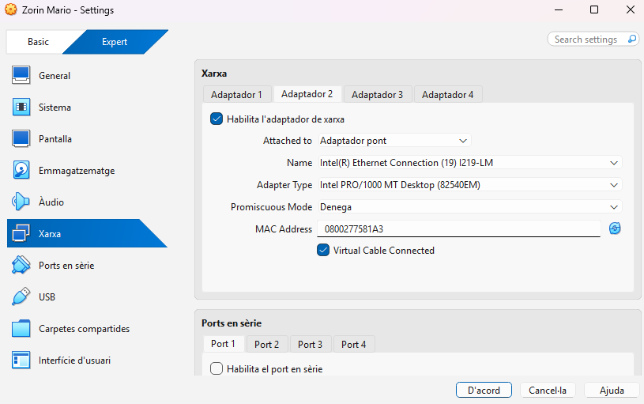

### Part A. Diagnosi avançada amb `dig` (Linux/macOS)

Executeu les comandes indicades a la consola de Linux i analitzeu els resultats obtinguts. Per mantenir les consultes relacionades, utilitzeu `tecnocampus.cat` per als registres A, NS i SOA. A la consulta inversa, substituïu el marcador per una de les adreces IP que us hagi retornat la primera comanda.

#### Comanda 1: consulta bàsica de registre A

```bash
dig tecnocampus.cat A
```

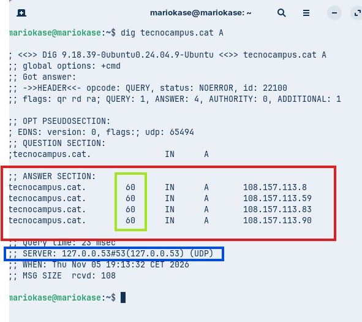

- **Anàlisi requerida:** Identifiqueu la IP de resposta, el valor del TTL i l'adreça del servidor DNS que ha respost a la consulta.

IPs de Resposta: 
1.- `108.157.113.8`

2.- `108.157.113.59`

3.- `108.157.113.83`

4.- `108.157.113.90`


Valor del TTL: `60`

Adreça del servidor DNS: `127.0.0.53`


#### Comanda 2: consulta de servidors de noms (NS)

```bash
dig tecnocampus.cat NS
```

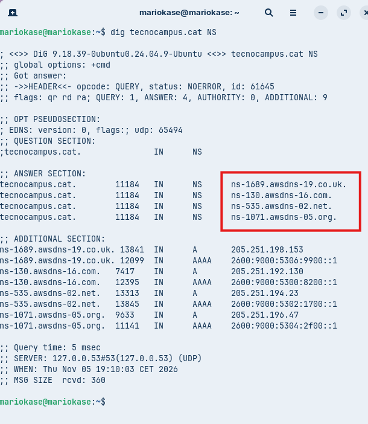


- **Anàlisi requerida:** Quins són els servidors de noms (*Name Servers*) autoritatius per a aquest domini?

Són els `.co .uk`, `.com`, `.net`, `.org`


#### Comanda 3: consulta detallada SOA

```bash
dig tecnocampus.cat SOA
```

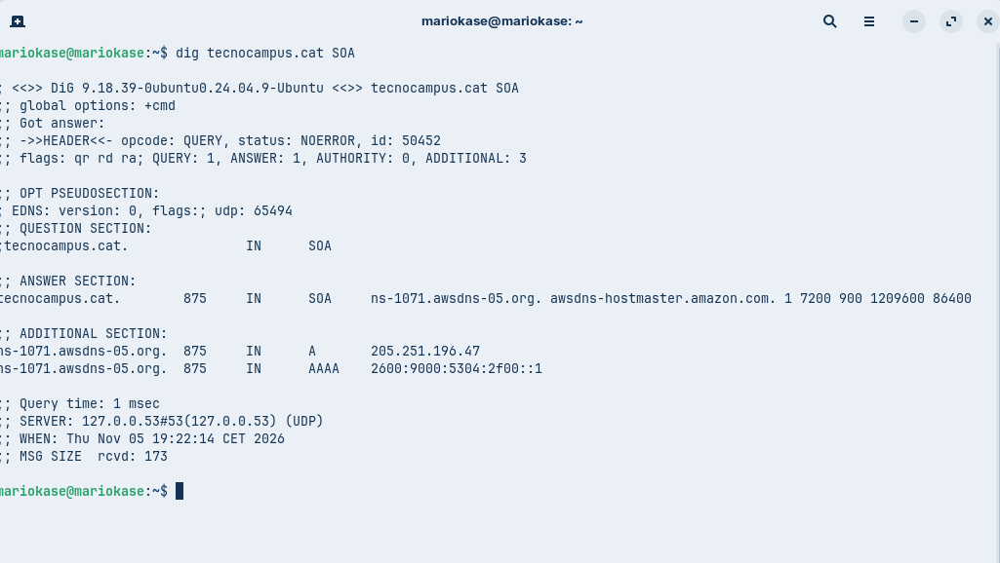

- **Anàlisi requerida:** Quina és la informació del correu de l'administrador (`rname`) i quin és el número de sèrie (`serial`) del domini?

- Correu de l'administrador: awsdns-hostmaster.amazon.com.
- Número de sèrie: 1


#### Comanda 4: consulta de resolució inversa

```bash
dig -x <IP_obtinguda_a_la_comanda_1>
```

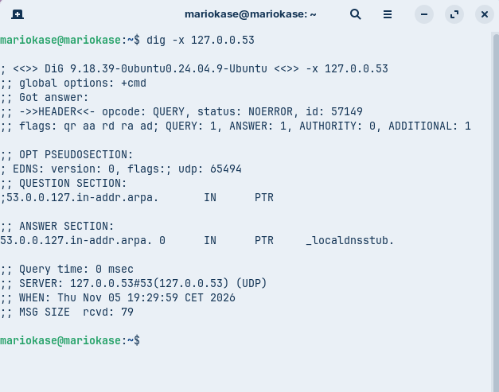

- **Anàlisi requerida:** Quina informació sobre els registres `PTR` s'obté i a quin nom de domini correspon aquesta IP?

Els registres PTR s'utilitzen per adreçar una adreça IP a un nom de domini.

Nom de Domini: _localdnsstub.

### Part B. Comprovació de resolució amb `nslookup` (mode interactiu amb Windows o Linux)

Exploreu l'ús de l'eina `nslookup` en mode interactiu executant la comanda `nslookup` sense arguments des de la terminal fins a veure el prompt (`>`).

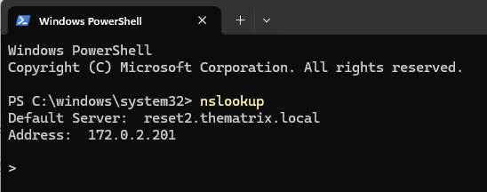

**Comandes clau del mode interactiu:**

- `set type=TIPO`: Defineix el tipus de registre a consultar (`A`, `AAAA`, `MX`, `NS`, `SOA`, `TXT` o `ALL`).
- `server IP_o_NOM`: Canvia el servidor DNS al qual es realitzarà la consulta.
- `exit`: Surt del mode interactiu.


#### Comanda 5: consulta bàsica no autoritativa

1. Dins del prompt de `nslookup`, configureu: `set type=A`.
2. Escriviu el domini de consulta: `tecnocampus.cat`.

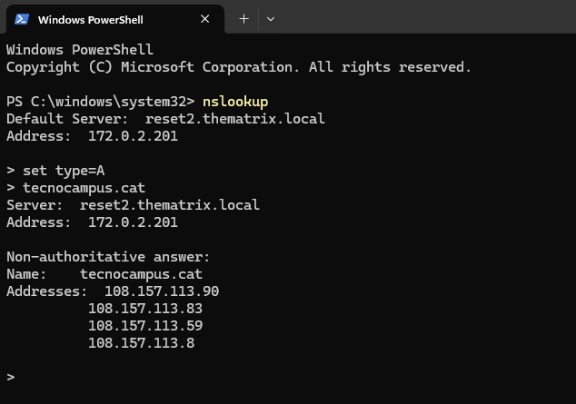

- **Anàlisi requerida:** Quina resposta dona la consola? Per què indica textualment que la resposta és **no autoritativa** (*Non-authoritative answer*)?

La consola dona: *"Non-authoritative answer"*

La resposta és no autoritativa perquè el servidor DNS no és el servidor autoritatiu directe.

#### Comanda 6: consultes autoritatives directes

1. Canvieu el servidor de consultes escrivint `server IP`, on la IP sigui la del primer servidor de noms autoritatiu obtingut a la comanda 2 per al domini `tecnocampus.cat` (per exemple, `server a9-66.akam.net` o la seva IP corresponent).
2. A continuació, configureu `set type=A` i consulteu de nou el domini `tecnocampus.cat`.

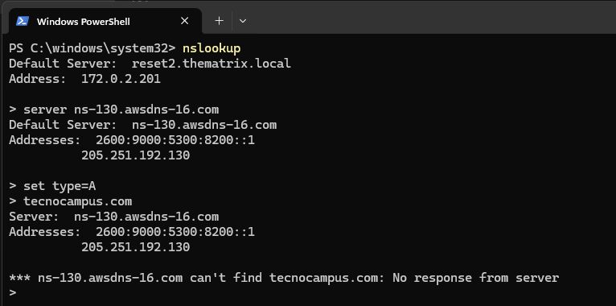

- **Anàlisi requerida:** Quines diferències s'observen en la resposta obtinguda respecte a la comanda 5? Comproveu si l'indicador "no autoritatiu" ha desaparegut.

Que ja no surt el missatge de *"Non-authoritative answer"*.

### Part C. Resolucions locals i protocol mDNS

Comproveu el funcionament de la resolució local sense servidor DNS dedicat (útil per a xarxes locals petites):

1. Verifiqueu el nom d'equip (*hostname*) de la vostra màquina Zorin OS.
2. Des d'un altre equip de la mateixa xarxa local (o xarxa bridged), executeu la resolució local mitjançant el domini `.local`:


```bash
ping <hostname>.local
```

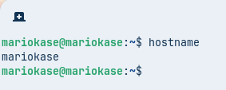

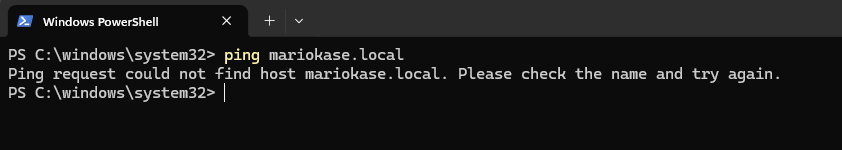

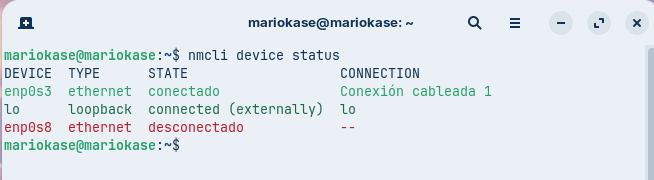


- **Anàlisi requerida:** Descriviu com funciona el protocol **mDNS** (*Multicast DNS*), quin port utilitza (UDP 5353) i quin avantatge aporta en entorns on no es disposa d'un servidor DNS configurat.

