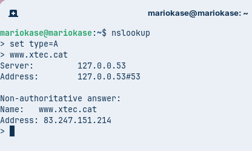
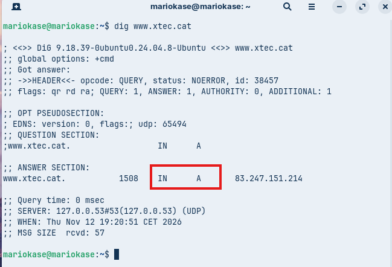
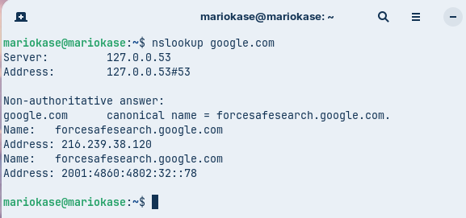
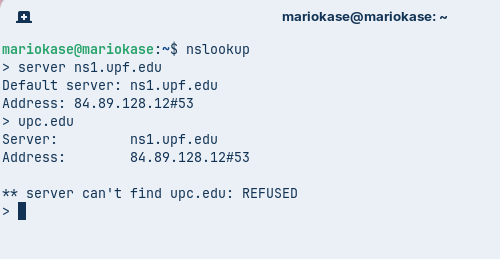
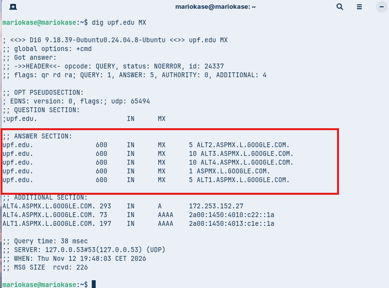
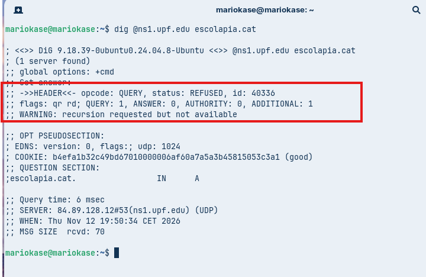
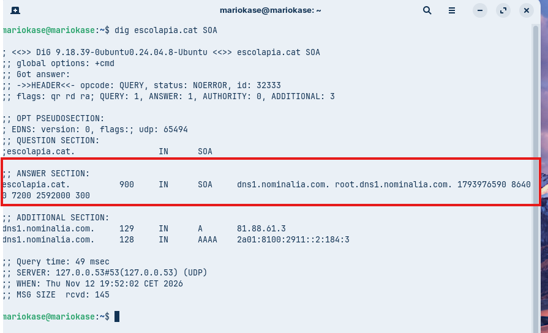
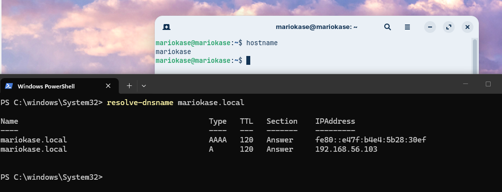

# Per practicar

1. Consulta la IP de la pàgina www.xtec.cat. Comprova que la resposta és no.autoritativa.

1. Fes una consulta usant el servidor de Google 8.8.8.8 per conèixer el NS (servidor de noms) del domini upf.edu.

1. Fes la consulta usant un dels servidors de noms de upf.edu de la pàgina www.upf.edu. Comprova com ara la resposta sí és autoritativa.

1. Consulta els dominis de correu de upf.edu.

1. Comprova que usant el servidor de noms de la UPF no pots fer una consulta del domini escolapia.cat

1. Mostra el registre SOA del domini escolapia.cat

1. Fes una consulta mDNS entre dues màquines virtuals.

Per consultar el mDNS, hem de fer la comanda `resolve-dnsname "nom de la maquina".local`, en aquest cas `resolve-dnsname mariokase.local`

